  <a href="https://github.com/Vishnubkrishna5329/microservices"><code>microservices</code></a> ·
  <a href="https://github.com/Vishnubkrishna5329/microservices-config"><code>microservices-config</code></a> ·
  <a href="https://github.com/Vishnubkrishna5329/multiple-datasource"><code>multiple-datasource</code></a> ·
  <a href="https://github.com/Vishnubkrishna5329/Java-Projects"><code>Java-Projects</code></a> ·
  <a href="https://github.com/Vishnubkrishna5329/Patterns"><code>Patterns</code></a>

  <a href="https://dev.to/vishnub33527201"><code>dev.to</code></a> ·
  <a href="mailto:vishnubkrishna471@gmail.com"><code>email</code></a>

